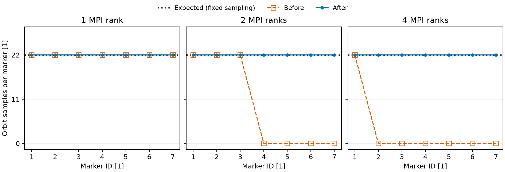

Seven synthetic collisionless alpha guiding centres in the analytic tokamak
field, with uneven marker partitions across 1, 2 and 4 MPI ranks. The independent
sampling reference is 22 records per marker: initial state plus 21 fixed steps
of 1 ns, because the stopping condition tests time strictly greater than 20 ns.
Marker weights are 1 through 7 particles/s; energies are 50 keV and pitches
span -0.9 to 0.9. No experimental data is used.

Before: 5d7ecde1295bdc33039d6b3615c54fd825861699. After:
fbe75f08124c12d8261509dcdf97d522e4d61191. All stored orbit fields agree exactly
across ranks after the fix; physical initial/endstates are unchanged, and
distribution bins and native density/energy-density moments agree within
relative tolerance 5e-14. CPU timing is excluded from physical-state comparisons.

The native regression is `TestMPIOrbit` in `a5py/testascot/unittests.py`.
`coverage.json` contains every plotted count; `python plot.py` reproduces the
figure. Missing marker records are displayed as zero.
